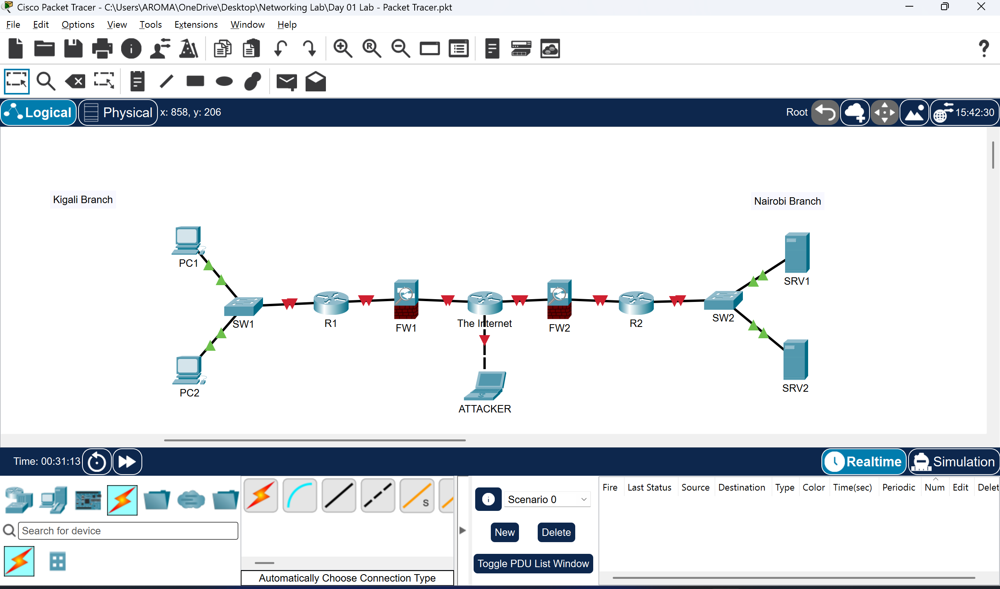

# Network Engineering Labs

**Hands-on networking practice with Cisco Packet Tracer**

This repository documents my development in computer networking, from identifying infrastructure devices and building network diagrams to future exercises in configuration, connectivity testing, troubleshooting, and network security.

I am an MS in Information Technology student at **Carnegie Mellon University Africa** developing foundational skills through practical, documented labs.

## Lab Index

| Lab | Topic | Evidence | Status |
| --- | --- | --- | --- |
| **01** | [Network Devices and Topology](lab-01-network-devices/README.md) | [Packet Tracer project](lab-01-network-devices/Day%2001%20Lab%20-%20Packet%20Tracer.pkt) · [Topology screenshot](lab-01-network-devices/topology.png) | **Topology documented; configuration not yet completed** |

## Lab 01 — Introduction to Network Devices

The first lab uses Cisco Packet Tracer to identify device roles and assemble a simplified two-branch topology. It includes Cisco 2911 routers, Cisco 2960 switches, Cisco ASA 5505 firewalls, PCs, servers, a laptop representing a potential attacker, and an additional router representing the Internet.

**What the lab demonstrates:** Device selection, placement, basic understanding of client/server and network-device roles, connections using Packet Tracer's automatic connection selection, and topology documentation.

**What it does not yet demonstrate:** Working IP addressing, verified end-to-end connectivity, configured routing, operational firewall policies, or tested security controls. Some links may not be operational. These are future activities—not completed results.

**[Read the full Lab 01 report →](lab-01-network-devices/README.md)**

## Learning Roadmap

My planned networking progression includes:

1. Networking concepts, network devices, and physical/logical topologies
2. IP addressing, subnetting, and basic connectivity tests
3. Ethernet switching, VLANs, and inter-VLAN routing
4. Routing, DHCP, DNS, NAT, and troubleshooting
5. Access control, firewalls, segmentation, and network security
6. Packet analysis, fault isolation, and documented validation

These are **planned areas of study**, not claims that the corresponding labs have already been completed.

## Documentation Standard

As each lab progresses, I aim to provide the objective, tools and topology, configuration details, commands where applicable, tests, observed results, troubleshooting steps, limitations, and lessons learned.

**Engineering workflow:** Understand → Configure → Test → Break → Troubleshoot → Explain → Document → Improve

---

**Related work:** [IT Support Home Lab](https://github.com/jakech-sys/it-support-homelab) · [GitHub Profile](https://github.com/jakech-sys)
