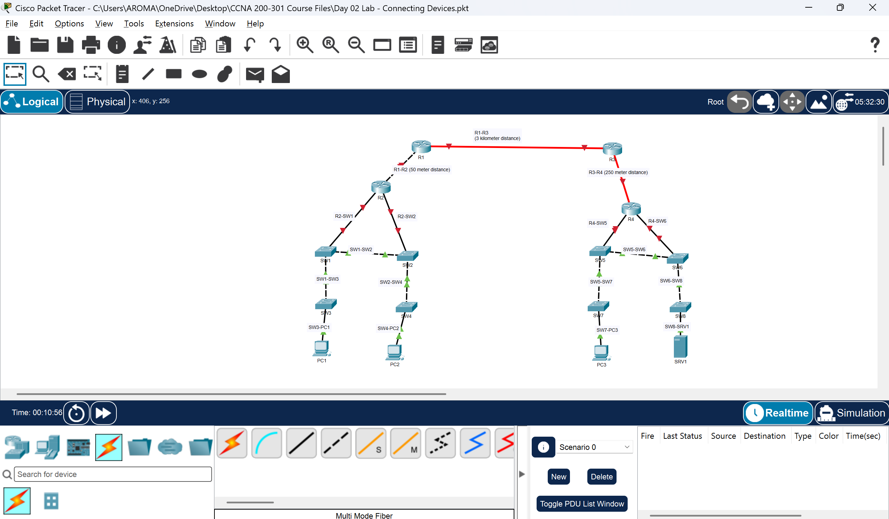

# Lab 02 — Network Cabling and Physical Connectivity

## Objective

I completed this Cisco Packet Tracer lab to select network cables and connect devices while **assuming Auto MDI-X is unavailable**. I practiced choosing copper straight-through and crossover cables and evaluating multimode and single-mode fiber for different link distances.

The completed objective was the construction of a cabled topology and the application of media-selection principles. IP addressing, routing, and end-to-end packet testing were not required for this exercise.

## Lab Environment

- **Tool:** Cisco Packet Tracer
- **Lab file:** [Day 02 Lab - Connecting Devices.pkt](Day%2002%20Lab%20-%20Connecting%20Devices.pkt)
- **Evidence:** [Topology screenshot](topology2.png)
- **Topology:** Two groups of access switches and end devices connected through routers, with a longer-distance link between the upper routers

The diagram includes four labeled routers (R1–R4), eight switches (SW1–SW8), three PCs (PC1–PC3), and one server (SRV1). It also labels illustrative link distances of **50 m, 250 m, and 3 km**. These distances are exercise assumptions, not field measurements.

## Cable Selection Principles

### Copper Ethernet when Auto MDI-X is unavailable

| Connection | Traditional cable choice | Explanation |
| --- | --- | --- |
| PC to switch | Straight-through | Typical MDI to MDI-X connection |
| Server to switch | Straight-through | Typical MDI to MDI-X connection |
| Router Ethernet interface to switch | Straight-through | Typically MDI to MDI-X |
| Switch to switch | Crossover | Typically MDI-X to MDI-X |
| Router Ethernet interface to router Ethernet interface | Crossover | Typically MDI to MDI |

**Important qualification:** “Same devices use crossover; different devices use straight-through” is a useful beginner mnemonic, **not a universal rule**. The decisive factor is the Ethernet interface's MDI/MDI-X behavior. Many modern interfaces support Auto MDI-X, which automatically compensates for the wiring arrangement. Actual firewalls and other devices require checking their port types and documentation.

For common twisted-pair Ethernet installations, the usual structured-cabling **channel** limit is **100 m**, subject to the applicable Ethernet standard and cable specification.

### Optical fiber

| Illustrative link | Appropriate consideration | Qualification |
| --- | --- | --- |
| **50 m** | Copper Ethernet can be appropriate | Requires a supported copper interface and a properly specified cable |
| **250 m** | Multimode fiber may be appropriate | Validate fiber grade, speed, optical transceivers, and allowable link loss |
| **3 km** | Single-mode fiber is generally appropriate | Requires compatible single-mode optical interfaces and sufficient optical budget |

**550 m is not a general boundary between multimode and single-mode fiber.** Supported reach varies by Ethernet standard, data rate, fiber grade, transceiver, and optical power budget. Fiber media also require compatible interfaces/modules at both ends.

## Topology Evidence

[Open the Packet Tracer activity](Day%2002%20Lab%20-%20Connecting%20Devices.pkt) · [View the full-size topology](topology2.png)

## Procedure

1. Opened the Day 02 exercise in Cisco Packet Tracer.
2. Reviewed the connected device types, interface relationships, and indicated link distances.
3. Applied traditional straight-through versus crossover selection rules while assuming Auto MDI-X was unavailable.
4. Considered multimode and single-mode fiber for the longer-distance links.
5. Examined the resulting connections in the logical topology.
6. Saved the Packet Tracer activity and captured a topology screenshot.

## Observations

- End devices, switches, and routers have different traditional Ethernet wiring requirements depending on interface type.
- Copper cabling is a practical option for local links within supported Ethernet distance limits.
- Fiber selection requires considering **both link distance and the physical-layer specifications**.
- The illustrative 3 km link motivates the use of single-mode optics; a 250 m link may support multimode optics when the chosen specifications permit.
- The completed Packet Tracer file and screenshot record my topology and cable choices. Network-layer performance and packet delivery were not the objectives of this lab.

## Completed Work and Scope

| Activity | Status |
| --- | --- |
| Network topology constructed in Packet Tracer | Completed |
| Copper and fiber media selection exercised | Completed |
| Cable type and distance considerations documented | Completed |
| IP addressing and routing configuration | Not part of this lab |
| Interface status and hardware compatibility tests | Not part of the documented test evidence |
| End-to-end ping and traffic verification | Outside the completed lab scope |

**Note:** Colored indicators in a Packet Tracer screenshot alone do not establish the cause of a down link. Device status, supported ports/modules, cabling, and interface configuration should be examined before diagnosing a failure.

## Lessons Learned

The correct physical connection is not determined solely by whether two devices are identical or different. Copper Ethernet cabling traditionally depends on interface pin assignments, while fiber links must satisfy distance, speed, connector, transceiver, and optical-budget requirements.

This activity reinforced why engineers verify hardware compatibility and physical-link behavior before troubleshooting IP addressing or routing.

## Next Steps

1. Inspect interface types and link status in Packet Tracer.
2. Document exact interfaces, cable choices, and any unsupported connections.
3. Configure IP addressing on a small, supported subset of the topology.
4. Verify connectivity with interface-status checks, ping tests, and documented results.
5. Publish reproducible configuration and validation evidence.

---

**Lab completion:** I completed the cable-selection and topology-construction exercise and retained the Packet Tracer file and screenshot as supporting evidence. Further network configuration and connectivity verification belong to subsequent labs.
